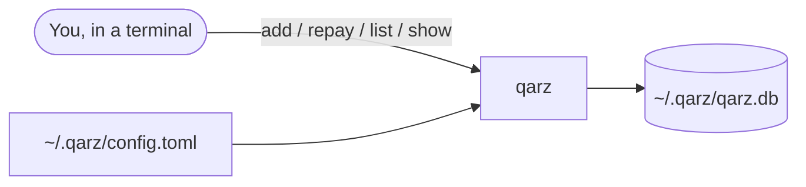

# qarz

[](https://github.com/KhizerRehan/qarz-cli/actions/workflows/ci.yml)
[](https://github.com/KhizerRehan/qarz-cli/releases/latest)
[](https://goreportcard.com/report/github.com/KhizerRehan/qarz-cli)
[](LICENSE)

A command-line ledger for interest-free loans you have made, kept in one SQLite file on your machine.

The ledger is the only source of truth. Money is stored as integer paisa, balances are derived on every read, and nothing is ever deleted.

## How it fits together



Everything runs on your machine, in one process, for the length of one command. There is no daemon, no server and no network access.

## Install

**Prebuilt binary.** Download the archive for your platform from the [latest release](https://github.com/KhizerRehan/qarz-cli/releases/latest), extract it, and put `qarz` somewhere on your `PATH`.

**With Go.** If you have Go installed:

```sh
go install github.com/KhizerRehan/qarz-cli/cmd/qarz@latest
```

**From source.**

```sh
git clone https://github.com/KhizerRehan/qarz-cli.git
cd qarz-cli
go build -o qarz ./cmd/qarz
```

Check it works with `qarz --version`.

## First run

There is nothing to set up. The first command creates `~/.qarz/qarz.db`:

```sh
qarz add --to Ali --amount 50000 --due 2026-12-15
```

## Commands

| Command | What it does |
|---|---|
| `qarz add` | Record a loan you made |
| `qarz list` | List loans, open ones by default |
| `qarz show <loan>` | One loan with its full repayment history |
| `qarz repay <loan>` | Record money a borrower paid back |

### Recording a loan

```sh
qarz add --to Ali --amount 50000 --due 2026-12-15
```

```
loan 7 recorded: Ali owes 50,000 PKR by 2026-12-15
```

Amounts are whole rupees. Commas are fine (`--amount 1,50,000`), and up to two decimal places are accepted. The date of lending defaults to today.

```sh
qarz add --to Sara --amount 80000 --due 2027-01-20 \
  --lent-on 2026-11-01 \
  --note "deposit for the flat" \
  --meta purpose=rent --meta via=bank
```

`--meta` takes any `key=value` pair, repeatable, for details the tool has no field for. They show up in `qarz show`.

### Recording repayments

```sh
qarz repay 7 --amount 20000
```

```
loan 7: Ali repaid 20,000 PKR, 30,000 PKR still owed
```

The balance is never stored, only derived, so it always matches the repayments behind it. A repayment larger than what is still outstanding is refused and names both numbers. When repayments reach the principal the loan becomes paid on its own:

```
loan 7 paid in full: Ali repaid 50,000 PKR
```

Repayments can be backdated and annotated:

```sh
qarz repay 7 --amount 30000 --on 2026-12-01 --note "cash, in person"
```

### Looking at loans

```sh
qarz list                 # open loans, the default
qarz list --overdue       # open loans past their due date
qarz list --paid          # repaid in full
qarz list --all           # everything
```

```
ID  BORROWER  BALANCE      DUE         STATUS
 2  Sara      80,000 PKR   2026-12-03  overdue 12d
 7  Ali       30,000 PKR   2026-12-15  open
```

```sh
qarz show 7
```

Prints the principal, what has been repaid, the balance, the status, both dates, the note, the extra details, and every repayment in order.

Nothing reminds you when a loan falls due, so check `qarz list --overdue` now and then.

## Files

| Path | What it holds |
|---|---|
| `~/.qarz/qarz.db` | The ledger. Backing up is copying this one file. |
| `~/.qarz/config.toml` | Timezone and currency. Optional. |

The defaults are a Pakistani setup (`Asia/Karachi`, `PKR`). To change them, create the file:

```toml
timezone = "Asia/Karachi"
currency = "PKR"
```

## What qarz does not do

No interest, markup, or late fees — a qarz is interest-free by definition, so the balance is always the principal minus what has been repaid. It tracks only loans you made, not money you owe. One person, one machine, one ledger file. No reminders, calendar or sync of any kind.

## Privacy

Everything stays on your machine. qarz makes no network calls: no telemetry, no analytics, no server of its own.

If you used an earlier build that pushed loans to Google Calendar, the events it made stay in your calendar until you delete them. qarz no longer reads `~/.qarz/credentials.json` or `~/.qarz/token.json`: revoke its access at <https://myaccount.google.com/permissions> and delete both files.

## Tests

```sh
go test ./...
```

Tests run at two seams: the command line, driven against a temporary ledger, and the domain arithmetic as table tests. Nothing in the suite touches the network. When you change command output on purpose, regenerate the golden files with `go test ./internal/cli -update` and review the diff.

## Contributing

Contributions are welcome. Read [CONTRIBUTING.md](CONTRIBUTING.md) to get started, and the [GLOSSARY](GLOSSARY.md) for the words the code uses. Please follow the [Code of Conduct](CODE_OF_CONDUCT.md), and report security issues privately as described in [SECURITY.md](SECURITY.md).

## License

[MIT](LICENSE)
