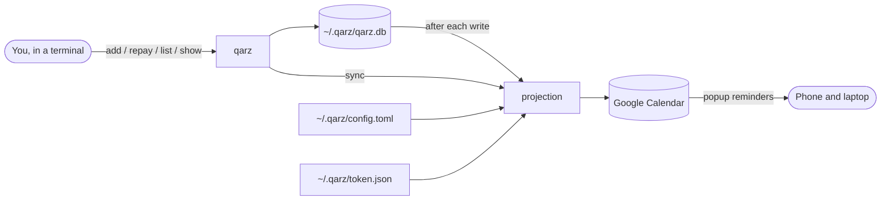

# qarz

A command-line ledger for interest-free loans you have made, projected one-way onto your Google Calendar so due dates arrive on their own.

The ledger is the only source of truth. The calendar is a projection of it and is never read back as authority: if the two disagree, the ledger wins. Money is stored as integer paisa, balances are derived on every read, and nothing is ever deleted.

## How it fits together



Everything runs on your machine, in one process, for the length of one command. There is no daemon and no server. A write lands in SQLite first and the calendar call happens afterwards, so losing the network costs you a reminder, never a record.

## Build and install

Run these yourself (the `!` prefix drops the output into this conversation so I can fix what breaks):

```sh
! cd /Users/khizerrehandev/orca/projects/QarzSystem && go mod tidy && go build -o qarz ./cmd/qarz
```

Then either `./qarz setup` from the repo, or put it on your `PATH`:

```sh
! cp /Users/khizerrehandev/orca/projects/QarzSystem/qarz /usr/local/bin/qarz
```

## First run

```sh
qarz setup
```

This walks the Google steps only you can do — creating a cloud project, enabling the Calendar API, configuring the consent screen, and producing a desktop OAuth client — then signs you in and writes your settings. It stops between steps and validates what you paste.

The ledger works before you ever run this. Without Google access every command still records and reads loans; it just warns that no calendar event was made.

## Commands

| Command | What it does |
|---|---|
| `qarz add` | Record a loan you made |
| `qarz list` | List loans, open ones by default |
| `qarz show <loan>` | One loan with its full repayment history |
| `qarz repay <loan>` | Record money a borrower paid back |
| `qarz sync` | Push calendar events that are still pending |
| `qarz setup` | Walk the one-time Google setup |

### Recording a loan

```sh
qarz add --to Ali --amount 50000 --due 2026-12-15
```

```
loan 7 recorded: Ali owes 50,000 PKR by 2026-12-15
```

Amounts are whole rupees. Commas are fine (`--amount 1,50,000`), and up to two decimal places are accepted. The date of lending defaults to today.

```sh
qarz add --to Sara --amount 80000 --due 2027-01-20 \
  --lent-on 2026-11-01 \
  --note "deposit for the flat" \
  --meta purpose=rent --meta via=bank
```

`--meta` takes any `key=value` pair, repeatable, for details the tool has no field for. They show up in `qarz show` and in the calendar event description.

### Recording repayments

```sh
qarz repay 7 --amount 20000
```

```
loan 7: Ali repaid 20,000 PKR, 30,000 PKR still owed
```

The balance is never stored, only derived, so it always matches the repayments behind it. A repayment larger than what is still outstanding is refused and names both numbers. When repayments reach the principal the loan becomes paid on its own:

```
loan 7 paid in full: Ali repaid 50,000 PKR
```

Repayments can be backdated and annotated:

```sh
qarz repay 7 --amount 30000 --on 2026-12-01 --note "cash, in person"
```

### Looking at loans

```sh
qarz list                 # open loans, the default
qarz list --overdue       # open loans past their due date
qarz list --paid          # repaid in full
qarz list --all           # everything
```

```
ID  BORROWER  BALANCE      DUE         STATUS
 2  Sara      80,000 PKR   2026-12-03  overdue 12d
 7  Ali       30,000 PKR   2026-12-15  open
```

```sh
qarz show 7
```

Prints the principal, what has been repaid, the balance, the status, both dates, the note, the extra details, and every repayment in order.

### When the calendar was unreachable

A mutating command that cannot reach Google still records the loan, warns, and exits zero:

```
loan 7 recorded: Ali owes 50,000 PKR by 2026-12-15
warning: recorded, but the calendar event is pending (run 'qarz sync')
```

```sh
qarz sync
```

```
pushed 1 of 1 pending loans
```

Safe to run whenever. If the calendar is still unreachable it says which loans are still pending and exits zero.

## What lands in your calendar

One event per loan, for the life of that loan — three loans to the same person stay three distinguishable events.

| Loan state | Event |
|---|---|
| Open | `Qarz: Ali — 30,000 PKR` on the due date, 09:00, popups one day before and ten minutes before |
| Overdue | `[OVERDUE 12d] Qarz: Ali — 30,000 PKR`, moved to today, one popup at 09:00 |
| Paid | `[PAID] Qarz: Ali — 50,000 PKR`, left in place, reminders cleared |

The title shows the balance while the loan is live, because that is the number that matters when the reminder fires, and the principal once it is paid, because that is what the loan was. The description carries the note, the extra details, the principal, the date of lending, and the loan number.

Every event is stamped with a private tag unique to its loan. That tag is how qarz recognises its own events and leaves the rest of your calendar alone.

## Files

| Path | What it holds |
|---|---|
| `~/.qarz/qarz.db` | The ledger. Backing up is copying this one file. |
| `~/.qarz/config.toml` | Calendar, timezone, currency. |
| `~/.qarz/credentials.json` | Your Google desktop OAuth client, owner-readable only. |
| `~/.qarz/token.json` | Your Google refresh token, owner-readable only. |

```toml
calendar_id = "primary"
timezone = "Asia/Karachi"
currency = "PKR"
```

## What qarz does not do

No interest, markup, or late fees — a qarz is interest-free by definition, so the balance is always the principal minus what has been repaid. It tracks only loans you made, not money you owe. One person, one machine, one ledger file. Nothing is read back from Google as truth, so an event edited by hand there will be rewritten.

## Tests

```sh
go test ./... -update   # first run, to create the golden files
go test ./...
```

Tests run at two seams: the command line, driven against a temporary ledger and an in-memory calendar, and the domain arithmetic as table tests. Nothing in the suite touches the network.
