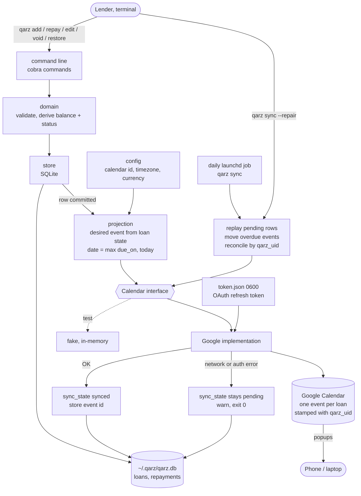

# Qarz — loan reminder system

Spec. Vocabulary is defined in `GLOSSARY.md` at the repo root and used exactly as written here: Loan, Borrower, Principal, Repayment, Balance, Open, Paid, Overdue, Projection. There are no ADRs yet.

Grilled and settled 2026-11-09, building on brainstorming session `cd850eba-df5c-4875-9e46-ae4747c8caf6`.

## Problem Statement

I lend money to people — interest-free, informal, no paperwork. The amounts are real and the dates matter, but nothing tracks them except my memory and scattered chat messages. Three things go wrong.

I forget who owes me. Not the big ones, but a loan from eight months ago with two partial repayments against it becomes a number I can no longer state with confidence, and I am not going to ask the borrower to remind me.

I forget when it was due. Even with the amount in mind, the due date arrives and passes without anything happening. By the time I remember, enough time has gone by that bringing it up feels like an accusation rather than a reminder.

And once a date has passed, nothing nags me. A loan that went unpaid two months ago is the one I most need to be reminded of, and it is exactly the one that has gone quietest.

A spreadsheet solves the first problem and neither of the others. A reminders app solves the second and loses the arithmetic. I want the arithmetic to drive the reminders.

## Solution

A command-line ledger that owns the numbers, and projects every loan onto my Google Calendar so the due dates arrive on their own.

I record a loan in one command. Each repayment is another command. The Balance is derived from those records every time it is read, never stored and never edited by hand, so the number the tool shows me is always the number the history supports.

Every Open loan has exactly one calendar event, titled with the Borrower's name and the current Balance, sitting on its due date. When a repayment lands, the title updates. When the final repayment lands, the event becomes `[PAID]` and its reminders are stripped. The calendar is a projection of the ledger and is never read back as truth — if the two disagree, the ledger wins and a repair rewrites the calendar.

Overdue loans keep reminding me. Once a due date passes, the event is moved forward to the current day and retitled with the number of days it is late, so it reappears on today's agenda instead of receding into last month. A daily background job performs that move, so it happens whether or not I have opened a terminal.

Nothing is ever destroyed. A loan I want gone is voided, not deleted: its calendar event is removed and it disappears from the default listing, but the loan and every Repayment against it stay in the database, and the void can be undone.

## User Stories

1. As a lender, I want to record a loan with a borrower, an amount, and a due date in a single command, so that recording a loan is faster than writing it down somewhere I will lose.
2. As a lender, I want the amount I type to be ordinary rupees, so that I never have to think about the integer representation underneath.
3. As a lender, I want a loan's date of lending to default to today but be settable, so that I can enter a loan I made last week without faking the date.
4. As a lender, I want to attach a free-text note to a loan, so that I can record what the money was for.
5. As a lender, I want to attach arbitrary key-value details to a loan, so that I can record things the tool has no field for without waiting for the tool to grow one.
6. As a lender, I want each loan identified by a small number, so that every later command is short to type.
7. As a lender, I want to be told the loan number as soon as the loan is recorded, so that I can use it immediately.
8. As a lender, I want to see every open loan in one listing, so that I can tell at a glance what I am owed.
9. As a lender, I want the listing to show each loan's balance rather than its principal, so that partial repayments are reflected without my doing arithmetic.
10. As a lender, I want to filter the listing to paid, overdue, or all loans, so that I can ask a specific question instead of reading everything.
11. As a lender, I want a single loan's full detail on demand — principal, balance, every repayment with its date, the note, the extra details, and a link to its calendar event — so that I can reconstruct the whole history of one loan.
12. As a lender, I want to record a repayment against a loan by number and amount, so that the ledger stays current as money comes back.
13. As a lender, I want a repayment's date to default to today but be settable, so that I can record a payment I received on Friday without lying about when it arrived.
14. As a lender, I want each repayment to be kept as its own record forever, so that a paid loan can always be shown to have been paid.
15. As a lender, I want a repayment larger than the outstanding balance rejected, so that a typo cannot produce a balance below zero.
16. As a lender, I want that rejection to name both the amount I typed and the balance available, so that I can see the mistake without going to look it up.
17. As a lender, I want a loan to become paid automatically the moment its repayments sum to its principal, so that I never mark a loan paid by hand.
18. As a lender, I want to correct a loan's amount after recording it, so that a mistyped principal does not force me to destroy and re-enter the loan along with its repayments.
19. As a lender, I want an amount correction rejected when it would fall below what has already been repaid, so that correcting a typo cannot produce a negative balance.
20. As a lender, I want to correct a loan's due date, borrower name, and note, so that the record can be fixed without being recreated.
21. As a lender, I want to void a loan, so that a loan I entered by mistake or wrote off stops appearing without its history being erased.
22. As a lender, I want a voided loan's calendar event removed, so that I stop being reminded about it.
23. As a lender, I want a voided loan still visible when I ask for it directly, so that I can see what I voided and when.
24. As a lender, I want to un-void a loan, so that voiding is a safe thing to do.
25. As a lender, I want one calendar event per loan, so that three loans to the same person stay three distinguishable reminders.
26. As a lender, I want the event title to carry the borrower's name and the current balance, so that the reminder alone tells me who owes what.
27. As a lender, I want the event to sit on the due date with a reminder the day before and a reminder shortly before it, so that I get advance warning and not only a same-moment alert.
28. As a lender, I want the event description to carry the note, the extra details, the principal, the date of lending, and the loan number, so that opening the event gives me the whole loan.
29. As a lender, I want the event retitled whenever the balance changes, so that the calendar never shows a number the ledger has moved past.
30. As a lender, I want the event moved whenever I change the due date, so that the reminder follows the agreement.
31. As a lender, I want the event marked paid and its reminders stripped on the final repayment, so that it stops alerting me but remains as a record.
32. As a lender, I want an overdue loan's event moved to the current day, so that it reappears on today's agenda instead of staying in the past.
33. As a lender, I want an overdue event's title to state how many days late the loan is, so that the reminder conveys urgency rather than just a name.
34. As a lender, I want the move to happen daily without my intervention, so that an overdue loan keeps surfacing even if I do not open a terminal for a month.
35. As a lender, I want a command that records the loan even when the calendar cannot be reached, so that a flaky network never costs me the record.
36. As a lender, I want to be warned when a calendar projection did not go through, so that I know the calendar is behind and what to run.
37. As a lender, I want a command that replays every projection that previously failed, so that a backlog clears in one step.
38. As a lender, I want a repair mode that reconciles the calendar in both directions — removing events whose loans are gone, creating events that are missing, and rewriting events that have drifted — so that I can restore the calendar to match the ledger from a single command.
39. As a lender, I want repair to be safely re-runnable, so that running it twice is never worse than running it once.
40. As a lender, I want repair to recognise only its own events, so that it never touches the rest of my calendar.
41. As a lender, I want repair to be safe even if I ever run this tool on a second machine, so that two ledgers cannot overwrite each other's calendar events.
42. As a lender, I want a guided one-time setup for Google access, so that the credential steps I have to click through myself are walked rather than guessed at.
43. As a lender, I want my Google token stored with private file permissions, so that it is not readable by anything else on the machine.
44. As a lender, I want setup to install the daily background job, so that overdue reminders work without a second configuration step.
45. As a lender, I want the calendar, timezone, and currency configurable in a file, so that the defaults can be changed without rebuilding.
46. As a lender, I want nonsensical input rejected rather than guessed at — a due date before the date of lending, an unknown loan number, a non-positive amount — so that the ledger cannot hold a state that makes no sense.
47. As a lender, I want a failing command to exit with a non-zero status, so that failures are visible to a script and to a shell prompt.
48. As a lender, I want the ledger to be a single local file, so that backing up my data is copying one file.

## Implementation Decisions

**Shape.** A Go command-line program. No daemon and no server: each invocation runs, writes, and exits. SQLite is the only source of truth. Google Calendar is a one-way Projection of it.

**Modules.** Six, with dependencies pointing inward:

- a domain module holding the loan and repayment types and the rules that derive Balance and status — no input or output of any kind
- a store module owning SQLite: migrations, pragmas, and all queries
- a projection module defining a Calendar interface, a Google implementation of it, and the rules that turn a loan's state into a desired event
- a command-line module holding the cobra commands and all output formatting
- a configuration module owning the config file and the stored token
- a wiring entry point that does nothing but assemble the above

**The seam before Google is an interface.** The projection module depends on a Calendar interface, not on the Google client. A fake in-memory implementation satisfies it, which is what keeps the tests off the network.

**Status is derived, never stored, with one exception.** Open, Paid, and Overdue are computed from the balance and the due date at read time. Void is the exception: it cannot be derived from anything, so it is stored as a nullable timestamp on the loan — null means live. Un-voiding clears it.

**Balance is derived in SQL.** A left join from loans to repayments with a coalesced sum, so that a loan with no repayments still appears and does not evaluate to null.

**Money is stored as integer minor units.** Paisa, never floating point.

**Dates are stored as `YYYY-MM-DD` text.** SQLite has no date type, and this format sorts and compares correctly as text.

**Loan identifiers are autoincrementing integers, and `AUTOINCREMENT` is specified deliberately.** A plain integer primary key recycles the identifiers of deleted rows in SQLite, and a recycled identifier means a stale calendar event claiming a new loan. The caller never supplies an identifier; the insert omits it and reads it back from the connection, which is scoped per-connection and so cannot return another writer's value.

**Every loan also carries a random globally-unique tag, separate from its integer identifier.** The tag is what the calendar event is stamped with and what repair matches on; the small integer stays in the command-line interface. This exists because autoincrement counts per database, so two machines would both produce a loan numbered 1 and repair run from either one would rewrite the other's event with no error — silent calendar corruption that nothing would report. The tag costs one column and makes that impossible.

**Currency is global, not per-loan.** A single value in the configuration file, defaulting to PKR. A per-loan currency column was rejected because the listing would then have no honest total to print, and mixed-currency support is worse as a half-measure than as an absence.

**There is no interest, ever, and this is a domain constraint rather than a missing feature.** No rate, no accrual, no markup. The Balance is always the Principal minus the sum of Repayments, which is what keeps the money arithmetic integer-exact.

**Only loans I made are recorded.** Money I owe other people is outside this context. This is why the party is named Borrower rather than something direction-neutral.

**Repayments are append-only.** They are never deleted or edited; the history of a loan is the proof that it was paid.

**Foreign keys must be enabled in the connection string.** SQLite ignores `REFERENCES` by default, which would make the repayment-to-loan relationship decorative. A busy timeout is set at the same time.

**Mutating commands write the database first and project afterwards.** A successful projection marks the loan synced. A failed one leaves the loan in its pending state, prints a warning naming the command to run, and exits zero — the record is already safe, so the failure is not an error.

**Projection rules, by loan state:**

| Loan state | Event |
|---|---|
| Open, not yet due | Borrower and Balance in the title, on the due date, a morning slot, popup reminders one day before and shortly before |
| Open, past due | Same event moved to the current day, title marked overdue with the number of days late, a single popup at the slot time |
| Paid | Title marked paid, showing the Principal rather than the Balance, reminders cleared, left in place as a record |
| Void | Event deleted |

**The title shows Balance while Open and Principal once Paid.** While the loan is live the number that matters is what is still owed; once it is closed the number that matters is what the loan was.

**An overdue event's date is derived, not stored.** The desired date for any loan is the later of its due date and the current day. This keeps repair a pure comparison between a computed desired state and the observed event, which is what makes it idempotent, and avoids a column whose only purpose would be remembering a value that can be computed.

**The daily move is installed as a background job during setup.** Manual replay alone was rejected: it makes calendar freshness depend on my having already opened a terminal, which is the gap that reminding-me-at-all is supposed to close. Mutating commands additionally perform the move in the calendar pass they are already making.

**Repair reconciles in both directions and matches on the unique tag, not the stored event identifier.** It lists every event carrying a tag, removes those whose loan is gone or void, creates those that are missing, and rewrites those whose title or date has drifted. Events without a tag are never touched.

**Void is reversible and does not require confirmation ceremony.** It is a single state transition that destroys nothing, so it does not need to be guarded like a deletion.

**Correcting a loan's amount is allowed, with a floor.** A new principal below the sum of existing repayments is rejected, naming both numbers; a new principal exactly equal to that sum is allowed and lands the loan on Paid.

**Google credential setup is a guided interactive script, not prose in a document.** Creating the cloud project, configuring the consent screen, and producing a desktop client identifier are console steps only a human can perform, so they are walked step by step with validation between steps rather than described and hoped for. The script also installs the daily job. The token is written with owner-only permissions.

**Rejected rather than guessed at:** a repayment above the outstanding balance, a due date before the date of lending, an unknown loan number, a non-positive amount, and an amount correction below what has been repaid. Each exits non-zero with a message naming the loan and the relevant numbers.

**Commands:**

```
qarz setup                          guided Google setup, token, daily job
qarz add --to --amount --due [--lent-on] [--note] [--meta k=v ...]
qarz list [--open|--paid|--overdue|--void|--all]    default --open
qarz show <id>
qarz repay <id> --amount [--on] [--note]
qarz edit <id> [--amount|--due|--note|--borrower]
qarz void <id>
qarz restore <id>
qarz sync [--repair]
```

## Testing Decisions

**What makes a good test here.** It drives the program the way I do and asserts only what I can observe: what was printed, what exit status came back, what the ledger now holds, and what the calendar was asked to do. No test reaches for an internal function to check that it was called, and no test asserts on the shape of a type rather than on behaviour. A test that would still pass after the internals were restructured, and would fail if the behaviour changed, is the one worth writing.

**Two seams, not four.** The original sketch proposed four — one per module. That was reduced to two.

The primary seam is the command line. A test builds the root command against a temporary database file and the fake Calendar implementation, runs an argument vector, and asserts on standard output, exit status, the resulting rows, and the events the fake recorded. This single seam already exercises the balance arithmetic, the migrations, the foreign-key pragma, the projection rules, the overdue move, the pending-replay path, and repair — all through behaviour rather than through internals. Golden files cover the listing and detail output.

The second seam is the domain module, table-driven over the Balance and status boundaries: zero repayments, partial repayment, exact-principal repayment, a repayment one unit above the balance, an amount correction at and below the repaid sum, and a due date exactly today versus one day past. These are pure functions over values, so a table is both cheaper and sharper than an argument vector, and no fixture is involved.

The store and projection modules get no separate test layer. Their behaviour is observable through the command-line seam, and testing them separately would couple tests to an internal structure that is expected to move.

**Specific cases that have to exist,** because each one covers a failure that would otherwise be silent:

- An insert of a repayment against a non-existent loan must fail. This is the test that stops the foreign-key pragma from regressing into a no-op, which it would do invisibly.
- Repair run twice must produce the same calendar both times.
- Repair must leave an untagged event untouched.
- A calendar failure during a mutating command must still leave the record committed, exit zero, and warn.
- A subsequent replay must clear that pending state.
- An overdue loan synced on two different days must land on each of those days in turn, with the day count in the title matching.

**Prior art.** None — this is the first code in the repository. These two seams and the fake Calendar are the prior art for whatever comes next, and new tests belong at the command-line seam unless they are pure arithmetic.

## Out of Scope

Money I owe other people. Only loans I made are tracked, and adding the other direction would rename the central noun and migrate the schema, so it is a deliberate exclusion rather than a deferral.

Interest, markup, late fees, and any form of accrual. Excluded by the domain, not by the roadmap.

Multiple currencies in one ledger, and currency conversion.

Multi-user and multi-machine operation. One person, one machine, one database file. The unique tag is there so that a second machine cannot silently corrupt the calendar, not so that two machines are supported.

Reading anything back from Google Calendar as authoritative. An event edited by hand in Google will be overwritten by the next repair, by design.

Partial forgiveness and write-offs as a distinct concept. Void covers the case, and does not pretend the money was repaid.

Any graphical or web interface, any notification channel other than Google Calendar, and any reminder to the borrower. The reminders are for me.

Reporting, analytics, charts, and export beyond what the detail and listing commands print.

Deleting data. Nothing in the tool destroys a row.

## Further Notes

Go is a learning goal for this project, which is part of why the scope is held this tight.

The build order stays as sketched, because each step leaves something usable:

1. Domain, store, migrations, and the add, list, repay, and show commands, with no calendar at all. That is already a working ledger.
2. Configuration and the guided setup, including the token.
3. The projection module and the Calendar interface, wired into the mutating commands.
4. Replay and repair, including the overdue move and the daily job.
5. Amount correction, void, and restore.

Defaults assumed and overridable in configuration: PKR, the `Asia/Karachi` timezone, and the primary calendar.

A worked example of the money arithmetic, on a 50,000 principal with repayments of 20,000 and 30,000:

| Step | Repayment rows | Sum of repayments | Balance | Status |
|---|---|---|---|---|
| after recording the loan | 0 | none, coalesced to 0 | 50,000 | Open |
| after a 20,000 repayment | 1 | 20,000 | 30,000 | Open |
| after a 30,000 repayment | 2 | 50,000 | 0 | Paid |

A third repayment of any amount is rejected: the outstanding balance is zero. An amount correction to 40,000 is also rejected, because 40,000 minus 50,000 repaid is below zero; a correction to exactly 50,000 is accepted and leaves the loan Paid.

---

# Implementation detail

Kept below the spec because it is useful while building and expected to drift. The spec above is what governs.

## Architecture and data flow



Two things this makes explicit: the interface seam before Google, which is why tests never touch the network, and the fact that a calendar failure lands in the database as a pending row rather than losing the record.

## Schema

```sql
CREATE TABLE loans (
  id                INTEGER PRIMARY KEY AUTOINCREMENT,
  qarz_uid          TEXT    NOT NULL UNIQUE,
  borrower          TEXT    NOT NULL,
  principal_minor   INTEGER NOT NULL CHECK (principal_minor > 0),
  lent_on           TEXT    NOT NULL,
  due_on            TEXT    NOT NULL,
  note              TEXT,
  metadata          TEXT,
  voided_at         TEXT,
  calendar_event_id TEXT,
  sync_state        TEXT    NOT NULL CHECK (sync_state IN
                      ('synced','pending_create','pending_update','pending_delete')),
  created_at        TEXT    NOT NULL,
  updated_at        TEXT    NOT NULL,
  CHECK (due_on >= lent_on)
);

CREATE TABLE repayments (
  id           INTEGER PRIMARY KEY AUTOINCREMENT,
  loan_id      INTEGER NOT NULL REFERENCES loans(id),
  amount_minor INTEGER NOT NULL CHECK (amount_minor > 0),
  paid_on      TEXT    NOT NULL,
  note         TEXT
);
CREATE INDEX idx_repayments_loan_id ON repayments(loan_id);
```

No cascade on the foreign key: nothing deletes a loan, so a cascade would only exist to enable an operation the spec forbids.

Balance query:

```sql
SELECT l.*, l.principal_minor - COALESCE(SUM(r.amount_minor), 0) AS balance_minor
FROM loans l LEFT JOIN repayments r ON r.loan_id = l.id
GROUP BY l.id;
```

Connection string, since SQLite ignores `REFERENCES` without the pragma:

```go
sql.Open("sqlite", "file:"+path+"?_pragma=foreign_keys(1)&_pragma=busy_timeout(5000)")
```

Insert omits the identifier and reads it back:

```go
res, err := tx.ExecContext(ctx, `
  INSERT INTO loans (qarz_uid, borrower, principal_minor, lent_on, due_on,
                     note, metadata, sync_state, created_at, updated_at)
  VALUES (?, ?, ?, ?, ?, ?, ?, 'pending_create', ?, ?)`,
  l.UID, l.Borrower, l.PrincipalMinor, l.LentOn, l.DueOn,
  l.Note, l.Metadata, now, now)
if err != nil {
  return 0, fmt.Errorf("insert loan: %w", err)
}
id, err := res.LastInsertId()
```

## Status derivation

```
voided_at is not null            -> Void
balance_minor == 0               -> Paid
balance_minor > 0, due_on < today -> Overdue
otherwise                         -> Open
```

## The tag, concretely

Two machines, two databases, both counting from 1, one shared calendar. Without a unique tag, repair run on the laptop sees the desktop's loan 1 as its own loan 1 and rewrites it:

| Step | Event found | Tag | Laptop database | Verdict | Action |
|---|---|---|---|---|---|
| 1 | `Qarz: Ali — 30,000 PKR` | 1 | loan 1 = Ali, 30,000 | matches | leave |
| 2 | `Qarz: Sara — 80,000 PKR` | 1 | loan 1 = Ali, 30,000 | drifted | rewrite to Ali |
| 3 | `Qarz: Imran — 12,000 PKR` | 2 | no loan 2 | orphan | delete |

With a random tag, steps 2 and 3 are events this database does not own and are left alone.
